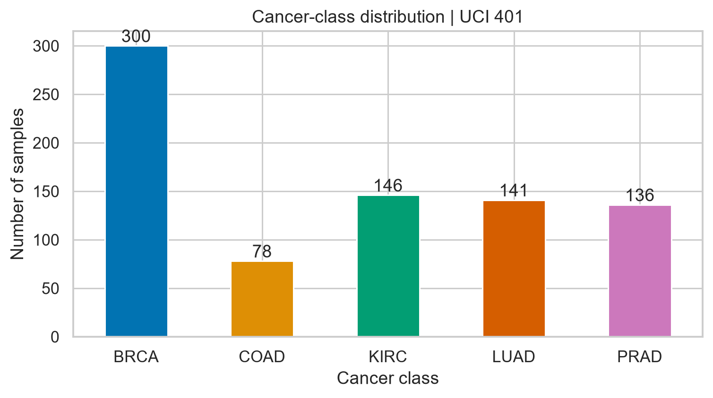
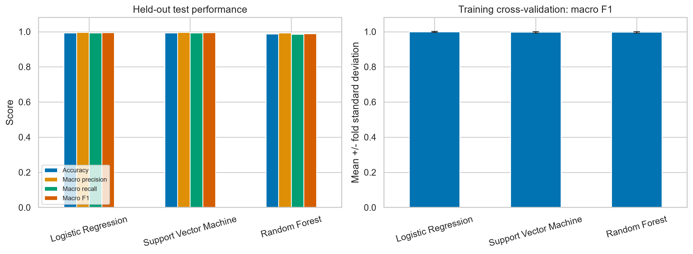
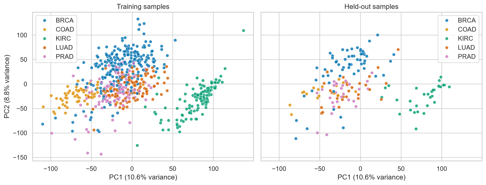
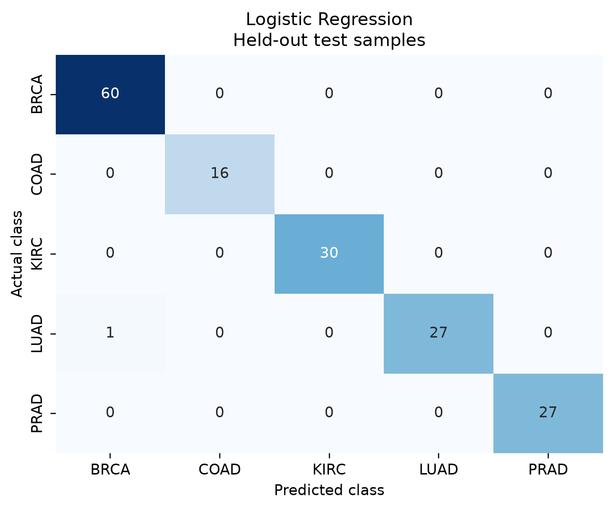
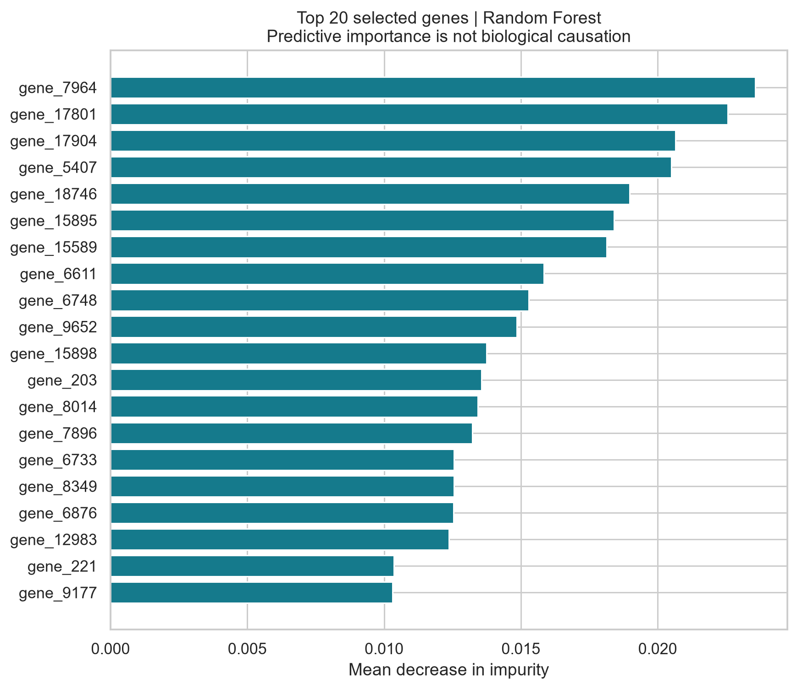

# Machine Learning-Based Cancer Classification Using Gene Expression Data

Academic bioinformatics project | 23 September 2026

## Abstract

This project evaluated supervised classification of five cancer types using UCI dataset 401. The observed matrix contained 801 samples and 20,531 expression features. A stratified split reserved 161 samples for testing and 640 for training. Constant-gene removal and training-only ANOVA selection retained 500 genes. Logistic Regression, a radial-basis-function Support Vector Machine and Random Forest were compared using five-fold training cross-validation. Logistic Regression was selected by mean macro F1 (0.9987, fold SD 0.0030). Its held-out accuracy was 0.9938 and macro F1 was 0.9947. These are internal benchmark results, not evidence of clinical diagnostic utility. Anonymized gene identifiers prevent verified gene-level biological interpretation.

## Introduction

Gene-expression measurements summarize transcript abundance across many genes. Computational analysis can compare these high-dimensional profiles and learn associations with known tumour classes. TCGA pan-cancer research provides a context for studying molecular similarities and differences across tumour types (The Cancer Genome Atlas Research Network, 2013). This project uses an educational expression benchmark to connect biological data handling with reproducible machine learning. It classifies existing tumour samples among five supplied labels; it does not detect cancer in healthy people.

## Problem statement

There are many more measured genes than samples, so a model can fit incidental patterns and produce optimistic results if gene selection uses evaluation labels. The central problem is to compare three classifiers under a leakage-controlled protocol and assess how well they distinguish the supplied classes on held-out samples. The question is predictive discrimination within this dataset, rather than causal gene discovery or clinical diagnosis.

## Aim and objectives

The aim is to analyse gene-expression data computationally and classify cancer types. Objectives are to validate dimensions and labels; audit missingness, duplicates and class imbalance; construct reproducible stratified splits; fit variance filtering, ANOVA selection and appropriate scaling within training folds; compare three algorithms with accuracy and macro precision, recall and F1; visualize class composition, PCA structure, performance and gene importance; preserve models and outputs; and critically interpret biological and computational limitations.

## Literature background

The TCGA Pan-Cancer analysis project established a framework for comparing molecular measurements across cancer types (The Cancer Genome Atlas Research Network, 2013). This motivates expression-based classification but does not establish clinical performance for the present subset. Ambroise and McLachlan (2002) showed that gene selection outside cross-validation can bias error estimates in gene-expression classification. Accordingly, every learned transformation here belongs inside the training pipeline. Scikit-learn documents pipeline-based protection against preprocessing leakage (Scikit-learn developers, n.d.-a). Random Forest impurity importance quantifies contributions to fitted tree splits, and can be misleading with correlated or high-cardinality variables (Scikit-learn developers, n.d.-b). It is therefore used descriptively, not as a test of biological significance.

## Dataset description

UCI dataset 401, contributed by Samuele Fiorini, is a subset of RNA-Seq HiSeq PANCAN expression data (Fiorini, 2016). Its five labels are BRCA (breast invasive carcinoma), KIRC (kidney renal clear cell carcinoma), COAD (colon adenocarcinoma), LUAD (lung adenocarcinoma) and PRAD (prostate adenocarcinoma). Rows represent samples; columns are anonymized gene measurements. Observed class counts were BRCA: 300, COAD: 78, KIRC: 146, LUAD: 141, PRAD: 136. The largest-to-smallest class ratio was 3.85. The data were retrieved using Official UCI ZIP archive (API unavailable). The requested API was attempted first; any failure is recorded in data/raw/provenance.json. No replacement or simulated data were used. The release is licensed CC BY 4.0 (Fiorini, 2016). Expression values were used as supplied; the available metadata did not establish a sufficiently detailed normalization recipe to justify claiming raw counts or adding another logarithmic transformation.

## Methodology

Random seed 42 was fixed throughout. A stratified 80:20 split produced 640 training and 161 test samples. Sample membership was saved. LabelEncoder was fitted on training labels; its integer mapping is only a coding scheme, not a biological ordering. The audit found 0 missing feature values, 0 missing labels and 0 extra duplicate expression rows. A median imputer is included inside each pipeline as a defensive step, but it changes no observed values when none are missing. Duplicate rows cause the loader to stop for investigation instead of silently splitting duplicate samples across sets. The cleaned export preserves supplied expression values and labels, without globally fitted scaling or selection.

## Feature processing and model specifications

VarianceThreshold(0) removed genes constant in the relevant training partition; on the complete training subset 20,254 genes remained. SelectKBest with the ANOVA F statistic retained 500 genes, a prespecified computational choice rather than a claimed optimal count. ANOVA ranks individual associations and can miss interactions or retain correlated genes; its rankings are not multiple-testing-corrected biological discoveries. StandardScaler was fitted after selection for Logistic Regression and SVM. Random Forest used unscaled selected values. Logistic Regression used L2 regularization, C=1 and max_iter=5000; SVM used an RBF kernel, C=1 and gamma=scale; Random Forest used 300 trees, sqrt feature sampling and otherwise library defaults. No hyperparameter search was performed. Five stratified shuffled folds of the training set were used, and every fold refitted imputation, variance filtering, ANOVA selection, scaling and the classifier. The selected model maximized mean macro F1; exact ties favor Logistic Regression, then SVM, then Random Forest. The selection was recorded before test evaluation. All three frozen specifications were then evaluated once on the same test set, without changing the selection based on test results.

## Metrics and visualization protocol

Accuracy is the proportion of correct predictions. Per-class precision is TP/(TP+FP), recall is TP/(TP+FN), and F1 is their harmonic mean. Macro scores average the five class scores equally, making minority classes visible despite imbalance. Confusion matrices use actual classes as rows and predicted classes as columns. A majority-class dummy classifier provides context. Cross-validation standard deviations describe fold variation, not confidence intervals. PCA used median imputation, constant-gene removal and scaling on training data, followed by a two-component randomized PCA with seed 42; held-out samples were only transformed. PCA used all nonconstant genes, separately from supervised ANOVA, and was not used as classifier input. Forest importance is mean decrease in impurity within the 500 selected features.

## Results

The selected model, Logistic Regression, correctly classified 160 of 161 held-out samples. Its accuracy was 0.9938, macro precision 0.9967, macro recall 0.9929, and macro F1 0.9947. A nominal 95% Wilson interval for its test accuracy was [0.9657, 0.9989], conditional on independent, identically distributed test observations; it does not cover domain shift or all model-selection uncertainty. The majority-class baseline achieved accuracy 0.3727 and macro F1 0.1086. PCA components explained 10.60% and 8.82% of training variance, totaling 19.42%; the two-dimensional projection therefore omits much of the variation. Full model comparisons and per-class outcomes follow. Random Forest ranked gene_7964, gene_17801, gene_17904, gene_5407, gene_18746 highest by training impurity importance. These are anonymous identifiers, not verified gene symbols.

### Table 1. Held-out test performance

| Model | Accuracy | Precision (macro) | Recall (macro) | F1 (macro) |
|---|---|---|---|---|
| Logistic Regression | 0.9938 | 0.9967 | 0.9929 | 0.9947 |
| Support Vector Machine | 0.9938 | 0.9967 | 0.9929 | 0.9947 |
| Random Forest | 0.9876 | 0.9935 | 0.9857 | 0.9893 |

### Table 2. Training-only five-fold cross-validation

| Model | CV accuracy | CV precision | CV recall | CV F1 | F1 fold SD |
|---|---|---|---|---|---|
| Logistic Regression | 0.9984 | 0.9992 | 0.9982 | 0.9987 | 0.0030 |
| Support Vector Machine | 0.9969 | 0.9984 | 0.9964 | 0.9974 | 0.0036 |
| Random Forest | 0.9969 | 0.9984 | 0.9964 | 0.9974 | 0.0036 |

### Table 3. Selected model: per-class test results

| Class | Precision | Recall | F1 | Support |
|---|---|---|---|---|
| BRCA | 0.9836 | 1.0000 | 0.9917 | 60 |
| COAD | 1.0000 | 1.0000 | 1.0000 | 16 |
| KIRC | 1.0000 | 1.0000 | 1.0000 | 30 |
| LUAD | 1.0000 | 0.9643 | 0.9818 | 28 |
| PRAD | 1.0000 | 1.0000 | 1.0000 | 27 |

## Discussion

Logistic Regression was chosen because it had the highest training cross-validation mean macro F1 under the prespecified rule. Its linear, regularized decision rule may match much of the discriminative structure in the ANOVA-selected features while limiting coefficient magnitude. This is a plausible computational explanation, not a demonstrated cause of superiority: no ablation, repeated nested cross-validation or formal paired comparison was performed. Small score differences do not establish that one algorithm is generally better. Strong separation, if observed, indicates that the supplied profiles contain information associated with the class labels in this sample collection. It may reflect tissue identity as well as tumour biology; this study cannot disentangle these effects. PCA plots describe variance structure, not diagnostic validity. The anonymous forest-ranked features may be useful predictors within this pipeline, but importance does not prove a causal role, differential expression or therapeutic relevance. Computationally, reducing the feature space from 20,531 measurements to 500 reduces the number of classifier inputs and helps control an otherwise severe features-to-samples imbalance; the project does not experimentally prove that 500 is optimal.

## Limitations

The dataset uses anonymized gene names, so no pathway enrichment, gene-function attribution or biomarker claim is justified without a verified identifier mapping. High machine-learning accuracy does not equal clinical usefulness. The sample size is small relative to gene count, making feature selection or other strong regularization necessary for a manageable, defensible analysis. A single random held-out split and five-fold internal validation do not establish transportability. Selecting among algorithms on cross-validation can make the selected CV result optimistic; the held-out test provides a separate internal check, not external validation. Fold variability is not a significance test. Patient, batch, centre, demographic, treatment and stage metadata were not available in the supplied feature/label tables for grouping or confounder adjustment; distinct expression rows do not prove independent patients. Tissue-of-origin and technical effects may contribute to predictions. The 500-gene choice and model defaults were not tuned or tested for stability. Impurity importance is training-derived and affected by correlation and split opportunities. No healthy controls, prospective validation, calibration, decision thresholds, clinical costs or outcome benefit were studied. Unknown classes cannot be recognized reliably by this closed-set classifier. Results must not be interpreted as medical diagnosis.

## Conclusion

A reproducible workflow was completed for five-class cancer classification using the observed UCI expression data. Training-only preprocessing, stratified evaluation and saved sample membership make the comparison auditable. Logistic Regression was selected by cross-validation and achieved held-out accuracy 0.9938 with macro F1 0.9947. The work demonstrates an academic application of machine learning to genomic measurements. Further work should validate on independent, well-annotated cohorts, evaluate grouped splits and feature stability, and obtain verified gene identifiers before drawing biological conclusions.

## Reproducibility and saved artifacts

Run python src/load_data.py, then python src/analysis.py, then python src/build_report.py from the project root, or execute the annotated notebook. The raw snapshot and provenance, cleaned CSV, split membership, per-gene statistics, CV fold scores, test predictions, class-level reports, figures and fitted pipelines are saved locally. The selected model remains fitted only on the original training subset so that its saved state matches the reported test evaluation. Saved bundles include the label encoder and ordered feature names. Loading joblib files executes trusted Python serialization; use only the project artifacts you trust. Environment versions and configuration are recorded in reports/tables/environment.json and requirements-lock.txt. The attached course outline was treated as contextual material; this report follows the explicit project request.

## References

Ambroise, C., & McLachlan, G. J. (2002). Selection bias in gene extraction on the basis of microarray gene-expression data. Proceedings of the National Academy of Sciences, 99(10), 6562-6566. https://doi.org/10.1073/pnas.102102699

Fiorini, S. (2016). Gene expression cancer RNA-Seq [Data set]. UCI Machine Learning Repository. https://doi.org/10.24432/C5R88H

Scikit-learn developers. (n.d.-a). Common pitfalls and recommended practices. Scikit-learn. Retrieved September 23, 2026, from https://scikit-learn.org/stable/common_pitfalls.html

Scikit-learn developers. (n.d.-b). Feature importances with a forest of trees. Scikit-learn. Retrieved September 23, 2026, from https://scikit-learn.org/stable/auto_examples/ensemble/plot_forest_importances.html

The Cancer Genome Atlas Research Network. (2013). The Cancer Genome Atlas Pan-Cancer analysis project. Nature Genetics, 45, 1113-1120. https://doi.org/10.1038/ng.2764